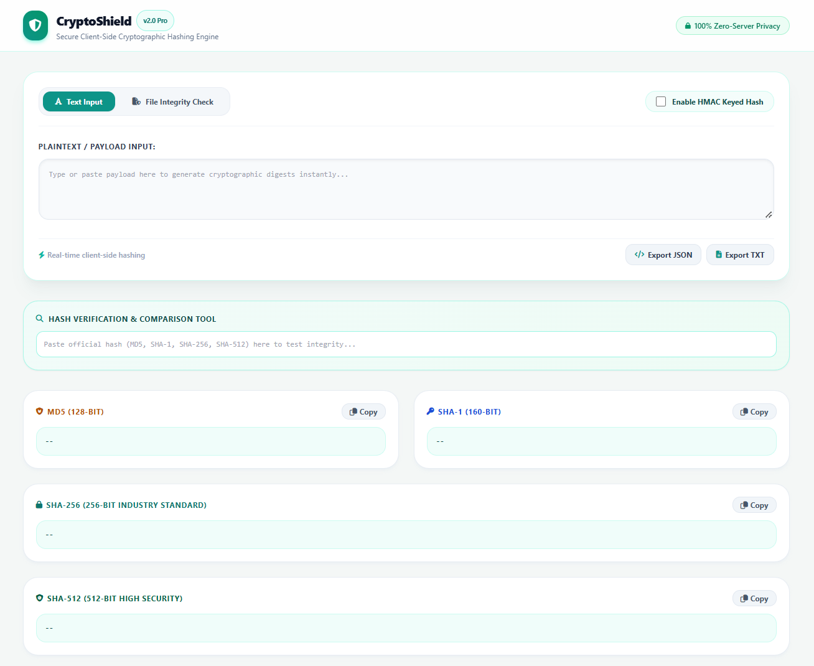
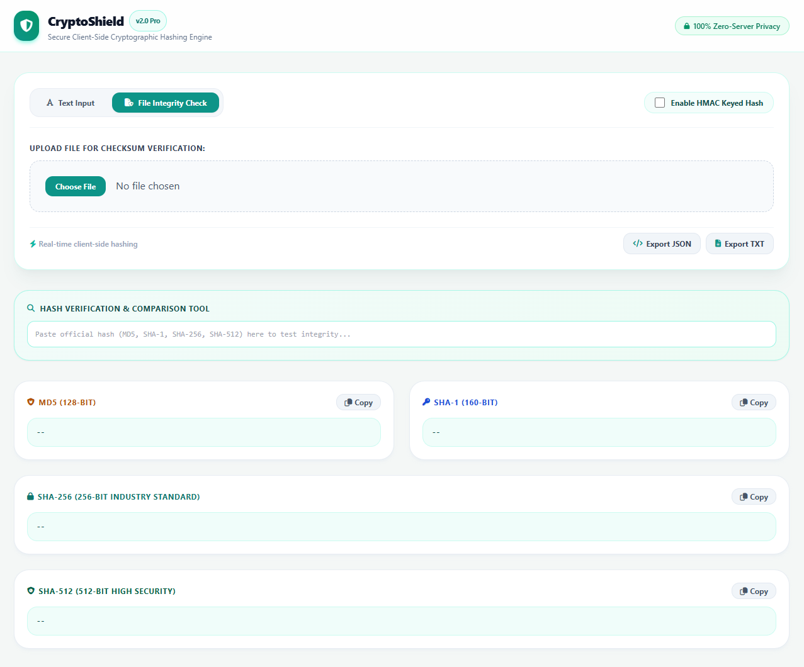

# 🛡️ CryptoShield Pro

A professional, lightning-fast, and 100% secure client-side cryptographic hashing and file integrity verification suite. This project is built for developers and security enthusiasts who need instant multi-algorithm hashing (MD5, SHA-1, SHA-256, SHA-512), HMAC key authentication, and live checksum validation with absolute data privacy.

---

## 🚀 Features

* **🔐 Multi-Algorithm Hashing:** Instant generation of MD5, SHA-1, SHA-256, and SHA-512 hashes.
* **📁 File Integrity Verification:** Upload any file or installer to check its cryptographic checksum and prevent payload tampering.
* **🔍 Live Hash Comparison:** Real-time hash matching engine with visual confirmation alerts (Match/Mismatch).
* **🔑 HMAC Keyed Mode:** Secret passphrase support for message authentication and API security.
* **📊 Bulk Export:** Export your generated cryptographic signatures instantly into **JSON** or **TXT** files.
* **🔒 Zero-Server Privacy:** All computations run locally inside your browser using the native `SubtleCrypto` API and CryptoJS. No files or text are ever uploaded to a server.

---

## 📸 Preview




---

## 🛠️ Tech Stack

* **Frontend:** HTML5, Tailwind CSS (Nordic Mint & Slate Theme)
* **Scripting & Cryptography:** Vanilla JavaScript, W3C Web Cryptography API (`crypto.subtle`), CryptoJS Library
* **Icons:** FontAwesome 6.4.0

---

## 🖥️ Preview / User Interface

*Modern, full-width responsive dashboard designed with a clean light theme, tabbed input modes, and real-side hashing.*

---

## ⚙️ How to Run

1. **Clone the repository:**
   ```bash
   git clone [https://github.com/00axa/cryptoshield-pro.git](https://github.com/00axa/cryptoshield-pro.git)